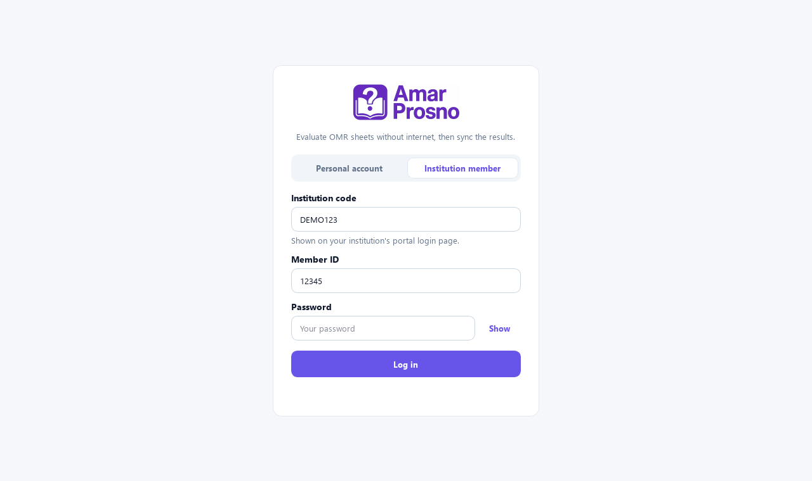
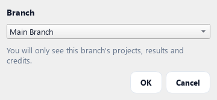
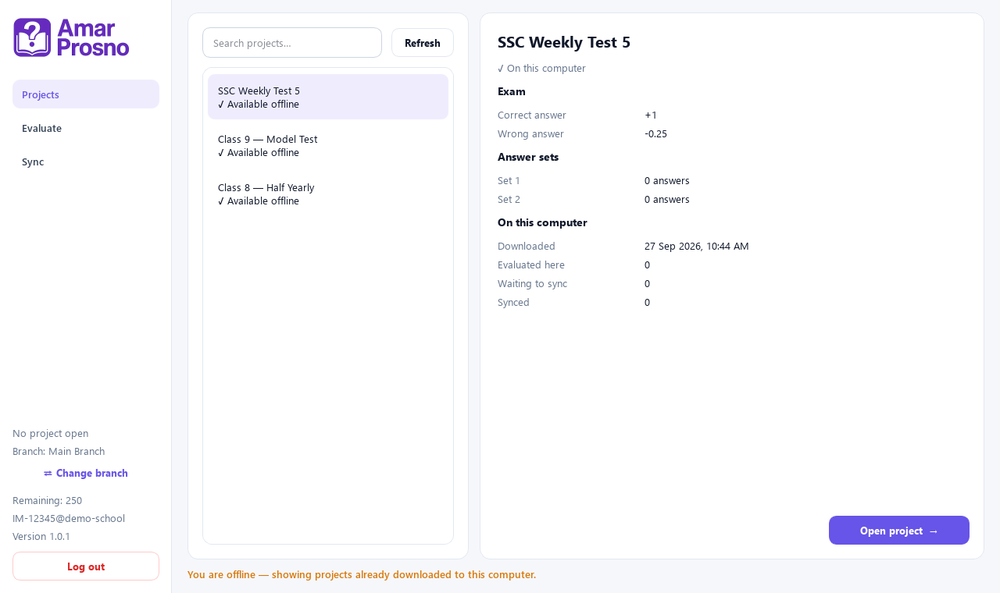
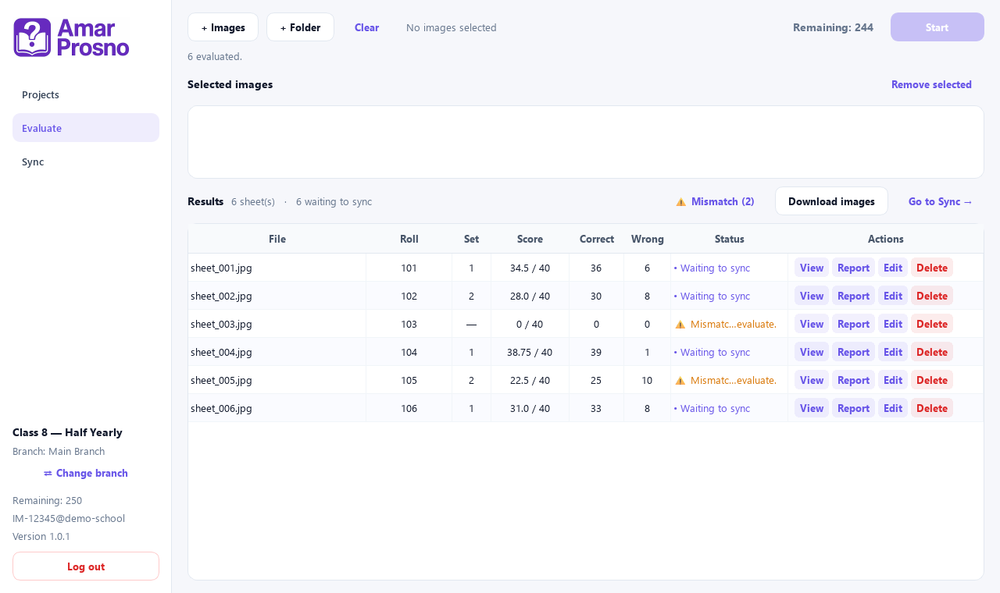
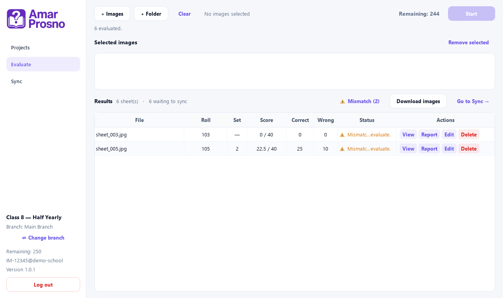
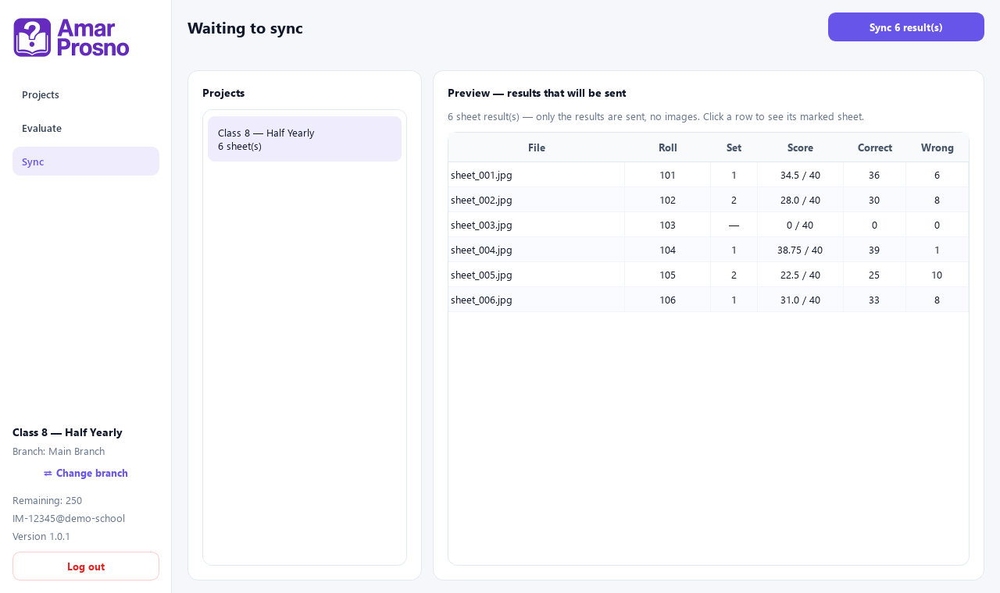
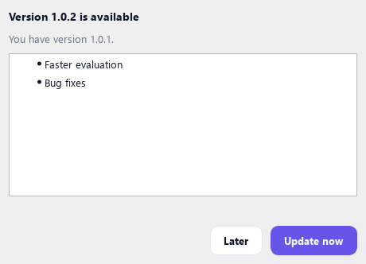

# AmarProsno OMR — Offline Desktop App

Check OMR sheets on your computer **without internet**, then send the results
to [amarprosno.com](https://amarprosno.com) when you are back online.

**[⬇ Download the latest version](https://github.com/avro0184/amarprosno-offline-omr-evaluation/releases/latest)**
— open the page, then click **AmarProsnoOMR-Setup-x.x.x.exe** under *Assets*.

> Windows 10 / 11 (64-bit). No admin rights needed.

---

## 1. Install

1. Download `AmarProsnoOMR-Setup-x.x.x.exe` from the link above.
2. Double-click it. If Windows shows *"Windows protected your PC"*, click
   **More info → Run anyway**.
3. Click **Next → Next → Install**, then **Finish**. The app opens by itself.

You only install once — later versions update from inside the app (see [Updates](#7-updates)).

## 2. Log in

Choose **Institution member** and enter your **institution code**, **member ID**
and **password** — the same ones you use on the institution portal.
(A personal amarprosno.com account works too: use **Personal account**.)

If your institution has more than one branch, pick the branch you work in.
You will only see that branch's projects, results and credits. You can switch
later with **⇄ Change branch** at the bottom left.

> Log in once while online. After that, the app keeps you signed in.

## 3. Open a project

Projects are created on the website (OMR → Projects). In the app, go to
**Projects**, select one to see its details (answer sets, marking), and click
**Open project →**. The project is saved on your computer, so it keeps working
offline.

## 4. Evaluate sheets

1. Click **+ Images** (pick scanned sheets) or **+ Folder** (a whole folder).
2. Click **Start**.
3. Each sheet appears in **Results** with roll, set, score, correct and wrong.

**Row actions**

| Button | What it does |
|---|---|
| **View** | Shows the marked sheet (✓ correct / ✗ wrong on each question) |
| **Report** | Question-by-question answers |
| **Edit** | Fix the roll or set. Changing the set re-checks the sheet with that set's answers |
| **Delete** | Removes the result from this computer |

**Remaining** (top right) is how many sheets your credits still allow. Credits
are used when results are synced.

## 5. Fix mismatches

If a student filled **two bubbles** in the same Set, Roll or Registration
column, the app does not guess — the row is marked **⚠ Mismatch**.
Click **⚠ Mismatch** above the table to see only those sheets, open **Edit**,
choose the right roll/set, and the sheet is checked again.

## 6. Sync results to the website

When you have internet, go to **Sync** and click **Sync N result(s)**.
Only the results are sent (no images), so it is quick even on mobile data.
The results then appear in the project on amarprosno.com.

To keep the marked sheet images, click **Download images** on the Evaluate
page — it saves them all (with a `results.csv`) in one ZIP file.

## 7. Updates

When a new version is released, the app tells you when you open it.
Click **Update now** — it downloads, installs and reopens by itself.
Your projects, results and login are kept.

---

## Questions

**Does it work without internet?** Yes — logging in, opening a project for the
first time and syncing need internet; evaluating sheets does not.

**Where is my data?** On your computer, in `%APPDATA%\AmarProsnoOMR`.
Uninstalling the app does not delete it.

**Uninstall:** Windows Settings → Apps → *AmarProsno OMR* → Uninstall.

**Help:** 01884689484 · 01572906168 (mobile / WhatsApp)
